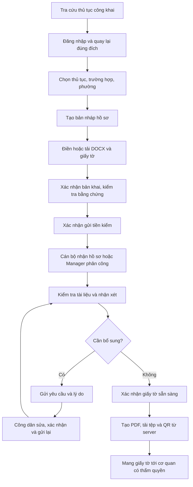

# Rà soát API, actor UI, validation và luồng chính — 27/10/2026

## Phạm vi và mức độ xác minh

- FE: nhánh `main`, điểm bắt đầu `789587a`, working tree sạch trước khi làm. BE: đọc source tại `E:/wardmate-backend`; không sửa BE, không chạy Git trong BE.
- Đã GET thành công 5 Swagger JSON trên Azure: IAM, Catalog, Workflow, DocumentForm qua gateway và AnalyticsSystem qua gateway. Tổng **148 HTTP operations**, gồm các route health; không coi tất cả là tính năng cần đưa lên UI.
- Bảng từng method/route, trạng thái tích hợp và đường dẫn lần theo: [API_UI_ENDPOINTS_2026-10-27.md](API_UI_ENDPOINTS_2026-10-27.md). Các endpoint AI bổ sung được đối chiếu source local, chưa xác minh Swagger AI riêng.
- Đọc route/permission, client, hook, màn hình và kiểm thử theo actor. Các lượt Playwright dùng mock, không có tài khoản Azure trong phiên này. Đọc được Swagger không chứng minh quyền thực tế, CORS/cookie production, migration hay worker đang hoạt động.
- Không tự bật lại tiếp nhận chính thức, phone/SMS, remember-me hoặc quản trị delivery SMS: các phần này đã có quyết định riêng trong bàn giao. Endpoint tồn tại không tự thay đổi phạm vi sản phẩm.

Các nguồn Swagger đã đọc:

| Dịch vụ / biến cấu hình | Swagger Azure |
|---|---|
| IAM — `VITE_API_BASE_URL` | [IAM](https://wardmate-iam.blackmeadow-a2f12767.japaneast.azurecontainerapps.io/swagger/v1/swagger.json) |
| Catalog — `VITE_CATALOG_API_URL` | [Catalog](https://wardmate-procedure-catalog.blackmeadow-a2f12767.japaneast.azurecontainerapps.io/swagger/v1/swagger.json) |
| Workflow — `VITE_WORKFLOW_API_URL` | [Workflow](https://wardmate-application-workflow.blackmeadow-a2f12767.japaneast.azurecontainerapps.io/swagger/v1/swagger.json) |
| DocumentForm — `VITE_DOCUMENT_FORM_API_URL` | [DocumentForm qua gateway](https://wardmate-gateway.blackmeadow-a2f12767.japaneast.azurecontainerapps.io/api/document-form/swagger/v1/swagger.json) |
| Analytics — `VITE_ANALYTICS_API_URL` | [Analytics qua gateway](https://wardmate-gateway.blackmeadow-a2f12767.japaneast.azurecontainerapps.io/api/analytics-system/swagger/v1/swagger.json) |

FE dùng `serviceUrls.ts` và HTTP client chung; `vite.config.ts` phân tuyến khi bật `VITE_USE_API_PROXY=true`. `.env.example` đã có đủ 5 URL người dùng cung cấp. Proxy Vite chỉ áp dụng môi trường phát triển; hosting production phải có cấu hình tương ứng hoặc CORS trực tiếp.

## 1. Kết quả API → UI

| Nhóm | Những luồng đã có lời gọi từ UI | Thiếu hoặc có giới hạn |
|---|---|---|
| IAM | Đăng ký/đăng nhập/khôi phục/đăng xuất, hồ sơ cá nhân, đổi/reset mật khẩu qua email OTP, tài khoản cán bộ, trạng thái tài khoản, phường, gán phường/lĩnh vực, role/permission/audit | Phone/SMS chưa bật; remember-me chưa có logic theo quyết định cũ; lọc trạng thái Admin chỉ trong trang hiện tại vì API không có bộ lọc đó |
| Catalog | Danh mục công khai/featured/chi tiết/PDF; quản lý thủ tục, danh mục, checklist, phiên bản, rollback, bản nháp PDF/OCR/đối soát/xuất bản | Các menu thành phần/quy trình/pháp lý là lối dẫn về thủ tục; chưa có kho văn bản pháp lý độc lập, lịch sử tổng hợp hoặc thống kê đầy đủ |
| Workflow | Tạo hồ sơ, danh sách/chi tiết, checklist, gửi/hủy/gửi lại, hàng đợi cán bộ, nhận/trả hồ sơ, giao/chuyển, nhận xét, phiên bản/diff, yêu cầu bổ sung/xác nhận sẵn sàng | Tiếp nhận chính thức có endpoint/client nhưng chủ động không có UI; số liệu phân công hiện phải dùng nhiều truy vấn đếm; hoạt động cán bộ chưa có API tổng hợp riêng |
| DocumentForm | Kho phôi DOCX; tạo/tải phôi; lưu/chỉnh sửa/chốt bản khai; giấy tờ minh chứng; cán bộ tải/chú thích/ra quyết định; tạo/tải PDF/ảnh QR | Không có endpoint quản lý phiên bản phôi hoặc cấu hình E-form riêng trong controller và Swagger đang đọc; editor hiện sửa DOCX, không nên mô tả là đã có đầy đủ engine E-form động. Tệp cũ theo phiên bản chưa có API snapshot nhị phân |
| Analytics | Sáu GET thống kê/phản hồi cho Manager; Admin tạo/tra job; công dân gửi/xem đánh giá theo hồ sơ | Chưa có lịch sử toàn bộ đánh giá, export hoặc trả lời phản ánh. Cần xác minh jobs/worker/coverage với dữ liệu thật. Delivery admin/SMS chưa bật |
| Thông báo | SignalR, danh sách/số chưa đọc/đánh dấu đã đọc, link về hồ sơ; công dân và cán bộ | Runtime phụ thuộc gateway, JWT, worker/RabbitMQ và phân quyền phường; mock không xác nhận vận hành thật |
| AI/OCR | OCR CCCD, chat công dân, gợi ý lý do bổ sung cho cán bộ | **Chưa nối** `documents/verify`, lịch sử chat sessions/messages và bộ API Knowledge/RAG. Admin/Procedure-manager có placeholder; không được gọi đây là đã tích hợp hết |

## 2. Những lỗi đã sửa

| Mức | Vấn đề trước sửa | Thay đổi |
|---|---|---|
| P1 | 404 xác nhận giấy tờ dẫn tới POST `/approve` cũ | Bỏ fallback ở cả Workflow và DocumentForm; giữ lỗi để người dùng kiểm tra, không gửi quyết định khác |
| P1 | Chat luôn gửi `WARD_001`; cán bộ thiếu phường cũng dùng mã đó | Công dân chọn phường từ API thật, kiểm tra lựa chọn trước gửi. Cán bộ chỉ dùng phường của hồ sơ; thiếu thì nhập lý do thủ công |
| P1 | Hội thoại công dân có thể giữ trong component qua thay đổi danh tính; reset khi request đang chạy có thể nhận câu trả lời cũ | Widget chỉ mở cho người đã xác thực, key theo user ID, hủy request khi unmount/reset và bỏ kết quả đã hủy; hội thoại không lưu storage |
| P1 | Admin/Manager lưu thông tin không qua schema của form | Dùng React Hook Form/Zod dùng chung, báo lỗi có liên kết focus về trường, khóa gửi lặp và giữ dữ liệu sau lỗi |
| P1 | API không có giới tính nhưng FE tự gán Nam, hiển thị đã xác thực/Kinh/Việt Nam | Giữ giới tính chưa cập nhật; bỏ trạng thái xác thực và giá trị nhân thân suy đoán |
| P1 | Số điện thoại `0912.345.678` được FE chấp nhận nhưng một số màn gửi nguyên dấu chấm, BE từ chối | Chuẩn hóa ở lớp API dùng chung cho tự sửa/Admin/Manager; không thay đổi quy tắc số điện thoại hiện có |
| P1 | Chữ tiếng Việt Unicode tổ hợp bị regex tên từ chối | Chuẩn hóa NFC trước validation/lưu; vẫn giữ quy tắc tên hiện có |
| P1 | Ngày sinh so với múi giờ máy khác với BE | So ngày hiện tại theo Việt Nam, giữ kiểm tra ngày tồn tại/năm hiện có |
| P1 | Trạng thái lạ bị đổi thành “Chờ tiền kiểm” ở cán bộ hoặc “Bản nháp” ở công dân | Hiển thị chưa xác định trạng thái; không cấp thao tác nhận/chỉnh sửa từ trạng thái không biết |
| P1 | Chi tiết công dân không kiểm tra ID response như phía cán bộ | Từ chối response thuộc hồ sơ khác |
| P1 | QR thiếu trên server bị thay bằng QR tạo qua qrserver.com, trỏ về danh sách hồ sơ và gửi mã hồ sơ ra ngoài | Bỏ dịch vụ QR ngoài và liên kết tự chế; chỉ hiển thị/tải blob QR từ backend. Có loading, lỗi, tải lại và mở chi tiết để tạo PDF |
| P2 | Sidebar thủ tục hiển thị cơ quan/thủ tục mẫu khi danh sách rỗng; gọi danh sách thường là “Tìm kiếm nhiều nhất” | Chỉ dùng dữ liệu API, đổi thành “Thủ tục khác”, loại thủ tục đang mở; có loading/error/retry/empty |
| P2 | Chat tràn màn hẹp, input chưa có nhãn, copy bị từ chối vẫn báo đã copy, reset có thể lẫn kết quả | Sửa kích thước theo viewport, nút mở thu gọn trên mobile, thêm nhãn/log, Escape trả focus, kiểm tra kết quả clipboard; giữ câu hỏi trong ô nhập khi gửi lỗi và bỏ tin gửi lỗi khỏi log để thử lại không lặp |
| P2 | Lỗi Zod từ upload hiển thị nguyên JSON kỹ thuật | Đi qua `documentFormError` để hiển thị tiếng Việt |
| P2 | OCR nhận ảnh rỗng, chọn file sai vẫn giữ ảnh/kết quả cũ; kết quả đang chạy có thể về sau khi đóng modal | Chặn ảnh rỗng, xóa lựa chọn/kết quả cũ trước kiểm tra, cho chọn lại cùng tệp; hủy request khi đóng/thay ảnh/unmount, khóa gửi lặp; nhập tay không tự gán Nam |
| P2 | Lỗi tải danh mục quản lý có thể hiện như danh sách rỗng | Hiển thị lỗi và nút tải lại |

Môi trường: khôi phục 16 dependency có sẵn trong lockfile nhưng chưa cài trên máy, gồm SignalR. Không thêm dependency hay đổi phiên bản; đã giữ nguyên `package-lock.json`. ESLint bỏ qua thư mục kết quả kiểm thử sinh tự động.

## 3. Rà soát và góp ý theo từng actor

| Actor / màn | Kết luận và đề xuất | Ưu tiên / phụ thuộc |
|---|---|---|
| Khách — trang chủ, danh sách, chi tiết | Giữ luồng tra cứu công khai, tìm kiếm/lọc và returnTo sau đăng nhập. Đã bỏ danh sách mẫu/xếp hạng không có dữ liệu. Nên kiểm tra khả năng tiền kiểm theo cấp/cơ quan bằng thuộc tính nghiệp vụ rõ ràng; chưa suy từ chuỗi tên cơ quan | P1, cần BE/PO chốt cờ đủ điều kiện tiền kiểm |
| Auth — đăng ký/đăng nhập/OTP | Có form, lỗi và chuyển trang; test lại hết phiên/403/mạng chậm. Checkbox nhớ đăng nhập vẫn chưa xử lý theo quyết định cũ. OTP thật cần cấu hình mail và tài khoản thử | P1 nghiệm thu thật |
| Công dân — tạo hồ sơ/danh sách/chi tiết | Bản nháp → tệp đã lưu → bản khai đã xác nhận → gửi tiền kiểm có các bước riêng. Nên bổ sung tóm tắt phường/trường hợp/tên tệp ở hộp kiểm tra trước gửi, tận dụng nội dung chi tiết hiện có | P2 đề xuất UX |
| Công dân — biểu mẫu/giấy tờ | Upload có giới hạn, số bản và điều kiện trạng thái. Giữ DOCX editor hiện tại; không quảng bá cấu hình E-form/phiên bản phôi chưa có hợp đồng. Đã sửa thông báo lỗi kỹ thuật và fixture upload | P1/P2 |
| Công dân — PDF/QR | Chỉ mở theo dữ liệu sẵn sàng; tạo PDF/QR do server, không tự vẽ QR. Nên làm rõ “chưa có QR → mở hồ sơ → tạo PDF → tải lại QR”, tránh mô tả QR đã tự sinh ngay sau tiền kiểm | P2, không giả QR |
| Công dân — thông báo/đánh giá/chat | Có SignalR và đánh giá theo hồ sơ. Chat đã sửa phường và lỗi gửi. Chưa có lịch sử chat/đánh giá toàn tài khoản; nên nối API chat history trước khi bổ sung mục lịch sử | P2/P3 |
| Cán bộ — dashboard/hàng đợi | Bộ lọc phạm vi/lĩnh vực, phân trang, nhận ngoài lĩnh vực có xác nhận. Dashboard ca trực/hiệu suất và audit tổng hợp còn placeholder vì thiếu API tương ứng; nên thu gọn các khối chưa có dữ liệu để tập trung hàng đợi | P2 UI; P1 API hiệu năng |
| Cán bộ — workspace tiền kiểm | Có xem giấy tờ, Word comments, nhận xét, bổ sung, xác nhận sẵn sàng và kiểm tra lại trước quyết định. Đã bỏ fallback quyết định cũ. Tệp phiên bản cũ mới có JSON diff, cần BE nếu muốn so sánh file theo lịch sử | P1/P2 |
| Quản lý — giám sát/phân công | Luồng giao/chuyển/trả có lý do, version chống xung đột và làm mới. Số khối lượng theo cán bộ gây nhiều request; nên ưu tiên API assignment-summary thay vì thêm biểu đồ FE tính trên một trang | P1 BE |
| Quản lý — nhân sự/chi tiết | Đã thêm validation và bỏ dữ liệu nhân thân suy đoán. Kiểm thử thật quyền theo phường, khóa tài khoản, xóa hồ sơ và chuyển lĩnh vực | P1 nghiệm thu thật |
| Quản lý — thống kê/phản hồi | Có ngày/phân trang/coverage, thiếu dữ liệu không tự đổi thành 0. Giữ thiết kế biểu đồ hiện tại. Hiển thị thời điểm tổng hợp gần nhất nếu API bổ sung; không dùng giờ browser thay cho thời điểm tổng hợp | P2, phụ thuộc DTO |
| Quản lý thủ tục — dashboard/danh mục/thủ tục | CRUD/checklist/version/PDF được nối; lỗi danh mục có retry. Menu hướng về cùng màn chỉnh thủ tục nên đổi nhãn/hướng dẫn thành lối tắt rõ ràng, tránh người dùng tưởng có phân hệ độc lập | P2 |
| Quản lý thủ tục — phôi/E-form/pháp lý/AI | Kho DOCX có thật. Phiên bản phôi, kho văn bản pháp lý độc lập chưa có endpoint trong hợp đồng đọc được. Knowledge có source BE nhưng chưa nối FE; cần một hạng mục tích hợp riêng với quyền, phân trang, import và lỗi index | P2/P3 |
| IT Admin — tài khoản/phường/RBAC/audit/job | Có lời gọi và quyền theo thao tác. Không mở nút xóa user trong Admin. Badge trạng thái phường đang ghi cứng “Hoạt động” vì DTO không có trạng thái; nên bỏ badge hoặc bổ sung field BE, không tạo toggle giả | P2 |
| IT Admin — giám sát/tri thức/tích hợp/sao lưu | Các màn còn placeholder. Knowledge API đã có source BE, là thiếu tích hợp thật. Health/traffic/backup không có hợp đồng quản trị phù hợp từ các controller đã đọc; không lấy health public làm số liệu vận hành đầy đủ | P2/P3 |

Các đề xuất là danh sách nâng cấp sau rà soát, không đồng nghĩa đã xây dựng các phân hệ mới trong lượt sửa lỗi này.

## 4. Main flow và điểm dừng

- UI có các bước của luồng tiền kiểm; chưa thể kết luận ổn trên production nếu thiếu kiểm thử Azure xuyên actor.
- Điểm dừng WardMate hiện tại là giấy tờ sẵn sàng/PDF/QR. Không tự mở lại tiếp nhận chính thức hay cấp biên nhận tại quầy.
- Các nhánh lỗi bắt buộc khi nghiệm thu thật: người khác đã nhận hồ sơ (409), sai phường (403/404), mất phiên, lưu tệp thành công nhưng đồng bộ lỗi, gửi lại cùng version, lỗi Blob/Gotenberg/worker.
- Các ràng buộc FE tên tối thiểu hai từ/100 ký tự, CCCD 12 chữ số, địa chỉ 5–255 ký tự và năm sinh từ 1900 đang chặt hơn ProfileInputValidator BE. Giữ quy tắc sản phẩm hiện có trong lượt này; cần chốt nghiệp vụ trước khi nới cho tên/giấy tờ nước ngoài, địa chỉ ngắn hoặc dữ liệu lịch sử.
- Lọc trạng thái hồ sơ công dân đang áp dụng trên trang đã tải, không phải toàn bộ tài khoản. Muốn số lượng/trang theo từng trạng thái chính xác cần bộ lọc server; không thay bằng tải toàn bộ dữ liệu ngầm.

## 5. Cách nghiệm thu thật còn cần

1. Có tài khoản thử được phép cho 5 vai trò, thuộc ít nhất hai phường; không đưa mật khẩu/token vào repository.
2. Chạy một hồ sơ thử xuyên actor theo sơ đồ; kiểm tra vòng bổ sung ít nhất hai lần, PDF và quét QR từ thiết bị chưa đăng nhập.
3. Kiểm tra FE production cùng cấu hình proxy/CORS/CSRF/cookie thực tế; Vite proxy thành công không xác nhận hosting production.
4. Kiểm tra OTP email, SignalR, worker/RabbitMQ, Analytics job/coverage, Blob và Gotenberg. Xác minh image/migration đang triển khai nếu source và runtime khác nhau.

## 6. Tài liệu tham khảo cho đề xuất UX

- [GOV.UK — Error summary](https://design-system.service.gov.uk/components/error-summary/): danh sách lỗi dẫn về câu trả lời cần sửa; dùng để định hướng lỗi form thay vì toast đơn lẻ.
- [GOV.UK — Check answers](https://design-system.service.gov.uk/patterns/check-answers/): cho kiểm tra lại dữ liệu trước khi gửi; phù hợp hộp xác nhận tiền kiểm.
- [W3C — Reflow](https://www.w3.org/WAI/WCAG22/Understanding/reflow.html): kiểm tra bố cục ở chiều rộng tương đương 320 CSS px, giữ khả năng dùng nội dung và thao tác.

## 7. Kết quả kiểm thử thực tế

- Typecheck, lint, build: đạt. Build còn cảnh báo kích thước chunk DOCX (khoảng 3,86 MB, gzip 1,20 MB) và annotation Zod bị bỏ qua.
- Playwright toàn bộ: **236/237 đạt**; một ca quên mật khẩu timeout khi nút bị tháo khỏi DOM/trang điều hướng lại, chưa kết luận nguyên nhân.
- Sau chỉnh cuối chat: chạy lại `full-audit`, `ui-audit`, `citizen-dossier-ui`, `auth-recovery`, một worker: **22/22 đạt**, gồm ca timeout ở trên. Chưa chạy lại toàn bộ 237 test sau hai chỉnh cuối riêng cho chat.
- Proxy check: **23/23 tuyến local đạt**, giữ nguyên đường dẫn/query; đây không phải phép thử CORS/proxy hosting production.
- `git diff --check`: đạt. Có ảnh kiểm thử và đã xem chat 320px, validation auth, hồ sơ công dân/cán bộ, dashboard Manager/Admin. Test tự động kiểm tra reflow và menu có focus trap/Escape cho cả 5 vai trò. Ảnh ở `test-results` không commit và bị ghi lại khi chạy test.
- Các test UI/API trên là **mock**. Azure chỉ xác minh Swagger và GET không đăng nhập: IAM users/me 401; Catalog categories 200; Workflow applications 401; gateway form-templates và analytics overview 401. Chưa nghiệm thu có xác thực hay ghi dữ liệu thật.

Thông tin tiếp tục công việc và giới hạn được ghi ở đầu [PROGRESS.md](PROGRESS.md).

## 8. Kiểm tra chốt đợt commit/push — 27/10/2026

- Sau các yêu cầu bổ sung về chat và hộp thư, chạy lại typecheck/lint/build: đạt, còn cảnh báo build đã biết. Proxy local 23/23 đạt.
- Bộ Playwright hiện có 244 test: lượt toàn bộ 243/244 đạt. Lỗi còn lại là fixture auth coi request negotiate mới của thông báo công dân là `/mock-private`.
- Cập nhật fixture `tests/auth.spec.ts` trả 503 cho negotiate, giữ nguyên assertion xác thực. Toàn bộ spec auth chạy lại 8/8 đạt; chưa chạy lại toàn bộ 244 ca sau thay đổi fixture. Không sửa source sản phẩm để xử lý lỗi test này.
- Người dùng yêu cầu chia đúng 20 commit và push lên main. Trạng thái Git được ghi tại đầu PROGRESS; bảng kết quả audit trước đó là ảnh chụp lượt kiểm tra tương ứng. Giới hạn chưa nghiệm thu Azure có đăng nhập vẫn giữ nguyên.
