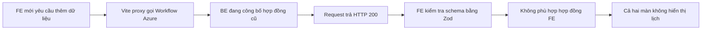

# Báo cáo nguyên nhân lỗi lịch làm việc và phương án khắc phục

## Trạng thái sau rà soát và sửa FE — 06/11/2026 (Asia/Saigon)

- Checkout đang kiểm tra là `E:/wardmate-backend`. Đã đọc lại contracts/controller/service và ràng buộc WF-WS-03: MonthlyView có 7 trường và draft chỉ nhận expectedVersion/baseFingerprint/slots/reason. Chưa có lưu ngày nghỉ cá nhân hoặc enforcement khóa lịch 24 giờ trước đầu tháng trong source này.
- FE hiện đã khôi phục dùng đúng hợp đồng đó trong commit `f175f8f`; phần mô tả FE bắt buộc bốn trường mới ở các mục bên dưới là bằng chứng lịch sử, không còn mô tả code hiện tại. Không cần bổ sung trường giả để vượt Zod.
- Rà soát tiếp đã sửa lỗi giữ trạng thái cũ sau HTTP 400 khi lưu/công bố, bổ sung kiểm tra ca qua đêm tại ranh giới tháng và hiển thị ca kéo dài sang ngày hôm sau trong danh sách. Kết quả kiểm tra mới và phạm vi chưa nghiệm thu thật nằm ở đầu `PROGRESS.md`.
- Ngày nghỉ bằng checkbox và hạn sửa lịch 24 giờ vẫn cần BE hỗ trợ và phát hành đồng bộ; không thể coi là hoàn tất chỉ từ FE. Publish hiện có outbox thông báo cho cán bộ có ca thay đổi, nhưng chưa kiểm chứng phát thông báo thật trên Azure trong lượt này.

## Đối chiếu lại checkout trên máy backend — 06/11/2026

- Backend thực tế bên cạnh FE là `D:/term 9/wardmate-backend`. `MonthlyScheduleContracts.cs` và `docs/api-guide.md` tại checkout này chỉ có MonthlyView với month/slots/baseFingerprint/draft/leaves/closures/confirmations; draft chỉ nhận expectedVersion/baseFingerprint/slots/reason. Không tìm thấy migration PersistScheduleDaysOff trong cây service Workflow này. Tham chiếu `E:/wardmate-backend` phía dưới là bằng chứng lịch sử ở checkout khác, không chứng minh máy hiện tại đã có source mới.
- Đã đọc lại Swagger Workflow Azure trực tiếp: MonthlyView và ScheduleDraftInput cũng có các trường cũ như trên. Lượt này URL Gateway `/swagger/v1/swagger.json` trả 404, không dùng làm bằng chứng schema Gateway hiện tại. Chưa đọc body lịch bằng phiên người dùng.
- Ảnh chọn request `/staffing/shifts` HTTP 200; `MonthlyScheduleView.tsx` gọi song song shifts (ca qua đêm từ tháng trước) và `/staffing/schedules/{month}`. `workSchedules.ts` bắt buộc daysOff/isPublished/canEdit/editDeadlineUtc và đổi mọi ZodError của lịch tháng thành thông báo yêu cầu cập nhật BE. Vì vậy mã 200 của shifts không xác nhận response lịch tháng hợp lệ.
- Ràng buộc WF-WS-03 tại backend hiện tại cho công bố ca tương lai hoặc giữ nguyên ca đã bắt đầu; chưa phải quy tắc khóa sửa trước tháng 24 giờ của FE mới. Không tự áp đặt quy tắc mới chỉ bằng sửa DTO.
- Hướng đề xuất: khôi phục hiển thị chỉ đọc cho hợp đồng cũ hợp lệ và báo lỗi schema chính xác; sau đó chốt giữ nghiệp vụ BE hiện tại hay nâng cấp đồng bộ ngày nghỉ/khóa lịch. Nếu giữ BE hiện tại, FE cần trở về đầy đủ semantics cũ cho luồng ghi. Nếu nâng cấp, cần bổ sung/tìm đúng source BE, lưu DB + migration, enforcement và outbox rồi deploy/nghiệm thu; deploy lại nguyên checkout hiện tại không bổ sung tính năng còn thiếu. Chưa sửa logic hoặc deploy trong lượt phân tích này.
Ngày lập: **06/11/2026, UTC+7**. Phạm vi: hai màn **Sắp xếp lịch tháng** và **Danh sách ca** trong ảnh người dùng gửi.

## 1. Kết luận

**FE mới đang yêu cầu hợp đồng dữ liệu mới, trong khi hai endpoint Swagger Azure được kiểm tra vẫn công bố hợp đồng cũ.** Vì vậy request có thể thành công HTTP 200 nhưng dữ liệu không vượt qua validation của FE, làm cả hai màn hình không hiển thị lịch.

Đây là **lỗi tích hợp, tương thích và phối hợp triển khai của phần thay đổi do agent thực hiện**. Không phải lỗi thao tác của người dùng. Chưa có bằng chứng để quy lỗi cá nhân cho một lập trình viên BE hoặc người vận hành deployment.

Agent chịu trách nhiệm đã đưa các trường mới thành bắt buộc trên FE trước khi xác minh môi trường BE đích hỗ trợ, chưa có phương án cho phép đọc dữ liệu cũ ở chế độ an toàn. Ghi chú “chưa deploy BE” là giới hạn đã ghi nhận, nhưng không thay thế việc giữ chức năng đọc hoạt động hoặc chặn phát hành FE không tương thích.

## 2. Bằng chứng đã kiểm tra

### 2.1. Ảnh giao diện

- Request lịch tháng `2026-11-01` và `2026-10-01` có HTTP **200**.
- Giao diện hiển thị: “API lịch chưa trả đủ dữ liệu ngày nghỉ và quyền sửa lịch. Cần cập nhật BE trước khi sử dụng.”
- Cả bảng tháng và danh sách cùng lỗi vì cùng gọi `workScheduleApi.month()`.
- Ảnh chưa mở tab Response của request tháng nên chưa xác định trực tiếp từng lỗi validation trong JSON nghiệp vụ có xác thực.

### 2.2. Hợp đồng FE hiện tại

Nguồn: `src/lib/api/workSchedules.ts`, phần `monthlySchema` và hàm `month()`.

FE bắt buộc có thêm các trường sau ngoài dữ liệu lịch cũ:

| Trường | Kiểu FE yêu cầu | Mục đích |
|---|---|---|
| `daysOff` | Mảng `{ officerId, date }` | Ngày nghỉ cá nhân đã công bố |
| `isPublished` | Boolean | Trạng thái tháng đã công bố |
| `canEdit` | Boolean | Quy tắc có thể sửa theo BE; FE vẫn kiểm tra quyền manage |
| `editDeadlineUtc` | Chuỗi thời gian hợp lệ | Hạn sửa lịch |

Trong hàm `month()`, mọi `ZodError` đều được chuyển thành cùng thông báo yêu cầu cập nhật BE. **Thông báo này hiện quá rộng:** sai kiểu hoặc sai một trường cũ cũng có thể gây cùng câu báo lỗi; nó không tự chứng minh bốn trường mới là toàn bộ lỗi trong response cụ thể.

### 2.3. Swagger đang triển khai

Đã đọc công khai, không dùng token và không gọi API ghi:

| Môi trường | Thời điểm kiểm tra UTC+7 | HTTP | Kết quả |
|---|---|---|---|
| [Gateway OpenAPI](https://wardmate-gateway.blackmeadow-a2f12767.japaneast.azurecontainerapps.io/api/application-workflow/swagger/v1/swagger.json) | 06/11/2026 13:41:45 | 200 | `MonthlyView` chưa có bốn trường mới |
| [Workflow trực tiếp OpenAPI](https://wardmate-application-workflow.blackmeadow-a2f12767.japaneast.azurecontainerapps.io/swagger/v1/swagger.json) | 06/11/2026 13:43:35 | 200 | Cùng hợp đồng lịch cũ; input draft chưa có `daysOff` |

`MonthlyView` được cả hai Swagger công bố có các trường:

```text
month, slots, baseFingerprint, draft, leaves, closures, confirmations
```

`ScheduleDraftInput` được công bố có:

```text
expectedVersion, baseFingerprint, slots, reason
```

`MonthlyRevisionView` qua Gateway cũng chưa có `daysOff`.

SHA-256 của snapshot OpenAPI Gateway tại thời điểm đọc:

```text
F16ABF47F5563B9CD5FF3DBE866953D83FEE3CD9DCA86D71BD434B3B68420D93
```

Đây là bằng chứng về **hợp đồng công khai đang triển khai**, không phải biên nhận đã đọc response lịch bằng tài khoản thật. Cần đối chiếu Response thực tế để xác nhận chính xác mọi trường sai/thiếu của request trong ảnh. Chưa kiểm tra image digest, traffic giữa các revision hoặc bảng migration trên DB Azure.

### 2.4. FE đang trỏ đến đâu?

Cấu hình development hiện có trong workspace:

```text
VITE_USE_API_PROXY=true
VITE_WORKFLOW_API_URL=https://wardmate-application-workflow.blackmeadow-a2f12767.japaneast.azurecontainerapps.io
```

`vite.config.ts` chuyển `/api/v1/staffing` đến `VITE_WORKFLOW_API_URL`. Vì thế sửa BE local không tự thay đổi BE mà FE development đang gọi. Việc kiểm tra cả host trực tiếp và Gateway giúp tránh quy kết nhầm rằng chỉ Gateway giữ hợp đồng cũ. Khi nghiệm thu vẫn phải ghi Request URL thật trong Network, vì ảnh chưa hiển thị URL đầy đủ.

### 2.5. Source mới và trạng thái triển khai là hai việc khác nhau

Source local BE đã có:

- `MonthlyScheduleContracts.cs`: `DaysOff`, `IsPublished`, `CanEdit`, `EditDeadlineUtc`.
- `SchedulePolicy.cs`: hạn sửa lịch đã công bố.
- Migration `20261106061808_PersistScheduleDaysOff`: thêm `days_off_json` vào `ward_schedule_revisions`.

`E:/wardmate-backend/PROGRESS.md` và `docs/PROGRESS.md` đều ghi rõ: **mới hoàn thành source local, chưa migrate DB/deploy Azure**.

Build Release, kiểm tra model EF và Playwright dùng mock đã đạt, nhưng các kết quả đó **không xác minh runtime BE Azure hoặc khả năng lưu DB/gửi thông báo thật**.

## 3. Cơ chế gây lỗi



HTTP 200 chỉ xác nhận request được xử lý thành công theo phía server. Nó không bảo đảm response đáp ứng một hợp đồng mới mà FE vừa tự chuyển sang yêu cầu.

Chọn lại tháng, bấm Thử lại hoặc xóa cache không bổ sung được trường mà server chưa hỗ trợ. Không nên chữa bằng cách bỏ validation hoặc gán `canEdit=true`, vì có thể mở sửa lịch trái hạn.

## 4. Đây là lỗi của ai?

| Phần việc | Trách nhiệm được xác định |
|---|---|
| Tích hợp FE và BE trong lượt thay đổi này | **Agent triển khai chịu trách nhiệm chính** về việc đưa FE sang hợp đồng bắt buộc mới khi chưa xác minh BE đích đã sẵn sàng |
| Trải nghiệm xem lịch khi server chưa cập nhật | **Phần FE do agent sửa còn thiếu tương thích chỉ đọc**, khiến cả dữ liệu lịch cũ cũng không xem được |
| Thông báo lỗi trên UI | **Phần xử lý lỗi FE do agent viết chưa đủ chính xác**, vì gom mọi lỗi schema thành một nguyên nhân |
| BE đang chạy trả cấu trúc cũ | Chưa thể gọi là lỗi xử lý request của BE: cấu trúc này phù hợp Swagger cũ đang công bố. Cần nâng cấp service để đáp ứng yêu cầu nghiệp vụ mới |
| Người triển khai/hạ tầng | Chưa có log phát hành, image digest hoặc yêu cầu deploy đã được phê duyệt để kết luận một cá nhân triển khai sai |
| Người sử dụng | **Không có lỗi**; chọn cán bộ và tháng là thao tác đúng |

Không được dùng kết quả mock để chuyển trách nhiệm sang BE. Đồng thời không được nói tính năng đã hoạt động trên Azure khi mới có source và build local.

## 5. Phương án khắc phục

### Bước 1 — Khôi phục khả năng xem lịch an toàn

**Đề xuất sửa FE, chưa triển khai trong lượt lập báo cáo này:**

- Tách nhận diện hợp đồng cũ và hợp đồng mới, thay vì để màn chỉ xem dùng chung điều kiện bắt buộc với chức năng sửa mới.
- Nếu response phù hợp hợp đồng cũ: vẫn hiển thị giờ ca và ngày nghỉ/lễ chung có thật, nhưng toàn màn ở **chế độ chỉ xem**.
- Ghi rõ “Máy chủ chưa hỗ trợ lưu ngày nghỉ cá nhân và sửa lịch theo quy tắc mới”. Không diễn giải ngày nghỉ cá nhân chưa có dữ liệu thành một mảng rỗng đã được xác nhận.
- Tắt tick Nghỉ, Sửa lịch, lưu draft và công bố. Không gọi vòng qua API tạo/hủy ca cũ để bỏ qua hạn sửa.
- Chỉ bật chức năng mới khi response đầy đủ, hợp lệ và quyền/nghiệp vụ cho phép.

Ma trận nhận diện cần có:

| Response | Hành vi FE |
|---|---|
| Hợp đồng cũ hợp lệ, không có nhóm trường mới | Hiển thị lịch cũ chỉ đọc; không cho ghi |
| Hợp đồng mới đầy đủ và hợp lệ | Hiển thị ngày nghỉ, trạng thái khóa và thao tác được BE cho phép |
| Hợp đồng bị trộn phiên bản/sai kiểu hoặc dữ liệu chung không hợp lệ | Báo lỗi dữ liệu cụ thể; khóa ghi, không giả hợp đồng hợp lệ |

Chẩn đoán kỹ thuật chỉ nên ghi đường dẫn trường lỗi và loại lỗi, ví dụ `daysOff: thiếu trường`; không ghi token, cookie hoặc toàn bộ dữ liệu cán bộ vào log. UI không nên khẳng định “BE chưa cập nhật” cho mọi `ZodError`.

### Bước 2 — Triển khai BE và migration đúng môi trường

Người phụ trách phát hành thực hiện theo `E:/wardmate-backend/AGENTS.md` và `docs/antigravity-azure-runbook.md`; báo cáo này không tự cấp phép push/deploy.

1. Xác định đúng database Workflow, service, image/revision và traffic của môi trường FE đang gọi.
2. Chuẩn bị rollback và kiểm tra migration trước phát hành. Không đoán database từ tên host FE.
3. Áp dụng migration `20261106061808_PersistScheduleDaysOff`. Đây là thay đổi thêm cột; dữ liệu cũ có `[]`, không suy đoán ngày nghỉ từ ngày thiếu ca.
4. Triển khai Workflow mới chứa DTO, lưu ngày nghỉ, hạn sửa và outbox. Không chỉ sửa Swagger hoặc thêm trường JSON giả để FE vượt validation.
5. Xác minh đúng revision nhận traffic ở host trực tiếp và qua Gateway; kiểm tra `/health/ready` cùng hợp đồng API. Health 200 riêng lẻ chưa đủ chứng minh tính năng mới hoạt động.
6. Xác nhận response thật bằng tài khoản kiểm thử trước khi bật chức năng ghi trên FE.

DB cần kiểm tra có cột `ward_schedule_revisions.days_off_json` kiểu `jsonb`, có migration tương ứng, và giá trị ngày nghỉ còn sau mở lại. Trong lượt báo cáo này không truy cập hoặc sửa DB Azure.

### Bước 3 — Nghiệm thu tích hợp thật rồi bật FE mới

| Kịch bản | Điều kiện đạt |
|---|---|
| Xem lịch | Chọn cán bộ/tháng; cả bảng tháng và danh sách hiển thị, không lỗi schema |
| Tick ngày nghỉ | Có PUT draft thành công; response xác nhận đúng `daysOff`; tải lại vẫn giữ dấu nghỉ trong bản soạn |
| Công bố | Ngày nghỉ xuất hiện trong lịch chính thức; mở lại bằng phiên khác vẫn đúng |
| Giữ lịch người khác | Sửa cán bộ A không làm mất ca hoặc ngày nghỉ của B |
| Khóa sau công bố | Mở lại chỉ xem; Sửa lịch chỉ xuất hiện với đúng quyền và còn hạn |
| Hạn sửa | Tháng 12/2026: mốc cuối 30/11/2026 00:00 Việt Nam; sau mốc BE từ chối ghi dù gọi API trực tiếp |
| Lưu trước hạn, công bố sau hạn | BE vẫn từ chối công bố sửa; không dùng giờ lưu draft để vượt hạn |
| Thông báo | Công bố lại thay giờ hoặc chỉ thay ngày nghỉ đều tạo thông báo IN_APP thật cho cán bộ bị ảnh hưởng; replay không tạo trùng |
| Phân quyền/phường | Cán bộ chỉ đọc lịch cá nhân; Manager không sửa dữ liệu phường khác |
| Hai Manager cùng sửa | Bản cũ bị từ chối khi version/fingerprint thay đổi; không mất nội dung đang sửa |
| API cũ | Không dùng create/cancel ca để vượt khóa lịch đã công bố |

Nếu không đủ điều kiện nâng BE, giữ FE ở chế độ chỉ đọc tương thích. Không hiển thị “Đã lưu” khi chỉ thay state trong trình duyệt.

## 6. Ngăn lỗi lặp lại và tiêu chí đóng sự cố

- Kiểm thử contract với cả mẫu response cũ và mới, không chỉ sửa mock cùng lúc với schema FE.
- Có smoke test đọc API đúng host đích, bằng phiên kiểm thử hợp lệ, trước khi phát hành FE yêu cầu trường mới.
- Bàn giao ghi rõ: source local, đã migrate, đã deploy, đã nghiệm thu; mỗi trạng thái cần bằng chứng riêng.
- Nhận diện phiên bản/tính năng bằng capability hoặc contract có quản lý; `OpenAPI.info.version = v1` không phải bằng chứng image đã cập nhật.
- Không xóa validation; tách quyền đọc dữ liệu cũ khỏi quyền ghi theo nghiệp vụ mới.

**Chỉ đóng sự cố khi:** người dùng xem được cả hai màn trên môi trường thực; ngày nghỉ lưu được sau tải lại; khóa/hạn sửa đúng; thông báo đến thật; người nghiệm thu ghi nhận host, thời điểm và phiên bản triển khai. Hiện đã xác minh lệch hợp đồng công khai và lập phương án; **chưa xác minh đã khắc phục trên Azure**.
