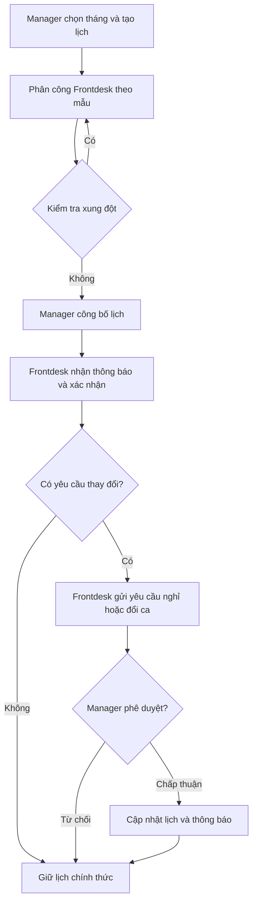

# KẾ HOẠCH FLOW QUẢN LÝ LỊCH LÀM VIỆC

**Module:** Work Schedule Management  
**Vai trò:** Manager và Frontdesk cấp xã  
**Phiên bản:** 1.0  
**Phạm vi:** Quản lý lịch làm việc nhân sự, không bao gồm tiếp nhận hồ sơ, quản lý quầy hoặc giao nhiệm vụ.

## I. Mục tiêu

- **Manager:** Lập lịch theo tháng, phân công nhân sự, điều chỉnh lịch, duyệt yêu cầu nghỉ/đổi ca.
- **Frontdesk:** Xem lịch cá nhân, xác nhận đã nhận lịch, gửi yêu cầu nghỉ/đổi ca.
- **Hệ thống:** Hỗ trợ sao chép lịch, kiểm tra xung đột, gửi thông báo và lưu lịch sử thay đổi.

## II. Phân quyền

| Chức năng | Manager | Frontdesk |
|---|---|---|
| Xem lịch tháng | Toàn bộ nhân sự thuộc phạm vi quản lý | Lịch cá nhân |
| Tạo lịch tháng | Có | Không |
| Sao chép lịch tháng trước | Có | Không |
| Phân công nhân sự | Có | Không |
| Chỉnh sửa và công bố lịch | Có | Không |
| Xác nhận đã nhận lịch | Theo dõi | Có |
| Gửi yêu cầu nghỉ/đổi ca | Không | Có |
| Phê duyệt yêu cầu | Có | Không |
| Xem lịch sử thay đổi | Toàn bộ thuộc phạm vi quản lý | Thay đổi liên quan đến mình |

## III. Flow Manager

### M01 — Tạo lịch làm việc theo tháng

1. Chọn tháng và năm.
2. Chọn **sao chép lịch tháng trước** hoặc **tạo lịch mới theo mẫu**.
3. Thiết lập ngày làm việc và ca làm việc (sáng, chiều hoặc cả ngày, theo cấu hình đơn vị).
4. Phân công Frontdesk cho các ngày/ca.
5. Hệ thống kiểm tra xung đột lịch, ngày nghỉ đã duyệt và ngày nghỉ lễ được cấu hình.
6. Manager xem trước và điều chỉnh từng ngày nếu cần.
7. Lưu nháp hoặc công bố lịch.
8. Khi công bố, hệ thống gửi thông báo cho Frontdesk liên quan.

**Nguyên tắc:** Không yêu cầu nhập thủ công toàn bộ 30–31 ngày. Ưu tiên lịch hành chính mặc định và chỉ chỉnh các ngoại lệ nếu nhân sự có giờ làm cố định.

### M02 — Chỉnh sửa lịch làm việc

1. Chọn lịch theo ngày, tuần hoặc tháng.
2. Chọn ca cần chỉnh sửa.
3. Thay đổi thời gian hoặc nhân sự.
4. Hệ thống kiểm tra xung đột.
5. Nhập lý do khi chỉnh sửa lịch đã công bố.
6. Lưu thay đổi, ghi nhận lịch sử và thông báo cho nhân sự liên quan.

### M03 — Phê duyệt yêu cầu nghỉ/đổi ca

1. Xem danh sách yêu cầu chờ duyệt.
2. Kiểm tra lý do, thời gian và lịch hiện tại.
3. Kiểm tra nhân sự thay thế khi cần.
4. Chấp thuận hoặc từ chối; yêu cầu nhập lý do khi từ chối.
5. Nếu chấp thuận, cập nhật lịch chính thức và gửi thông báo.

### M04 — Theo dõi lịch nhân sự

1. Xem lịch tổng hợp của đơn vị.
2. Theo dõi Frontdesk đã/chưa xác nhận.
3. Xem lịch nghỉ và các thay đổi ca.
4. Phát hiện ca chưa có nhân sự phụ trách.

## IV. Flow Frontdesk

### F01 — Xem và xác nhận lịch

1. Đăng nhập.
2. Mở **Lịch làm việc của tôi**.
3. Xem lịch theo ngày, tuần hoặc tháng.
4. Xem chi tiết ngày/ca được phân công.
5. Xác nhận **đã nhận lịch** (không đồng nghĩa với chấm công hoặc hoàn thành ca).

### F02 — Gửi yêu cầu nghỉ hoặc đổi ca

1. Chọn ngày/ca cần điều chỉnh.
2. Chọn loại yêu cầu: nghỉ hoặc đổi ca.
3. Nhập lý do và thời gian/phương án đề xuất.
4. Gửi yêu cầu cho Manager.
5. Theo dõi kết quả phê duyệt.
6. Lịch chính thức chỉ thay đổi sau khi được Manager duyệt.

**Không triển khai F03:** Tiếp nhận người dân theo lịch nằm ngoài phạm vi module này.

## V. Flow tổng thể

## VI. Quy tắc nghiệp vụ

| Mã | Quy tắc |
|---|---|
| BR01 | Mỗi đơn vị có một bảng lịch chính cho mỗi tháng; có thể lưu các phiên bản chỉnh sửa. |
| BR02 | Cho phép sao chép lịch tháng trước và áp dụng mẫu tuần. |
| BR03 | Ngày/giờ làm việc mặc định theo cấu hình thực tế của đơn vị; xử lý ngày nghỉ lễ và ngoại lệ. |
| BR04 | Một Frontdesk không được có hai ca trùng thời gian. |
| BR05 | Không phân công vào thời gian nghỉ đã được phê duyệt. |
| BR06 | Chỉ Manager được tạo, công bố và sửa lịch chính thức. |
| BR07 | Frontdesk không được tự sửa lịch chính thức. |
| BR08 | Yêu cầu nghỉ/đổi ca chỉ có hiệu lực sau khi được phê duyệt. |
| BR09 | Chỉnh sửa lịch đã công bố phải lưu người sửa, thời gian, nội dung và lý do. |
| BR10 | Thay đổi lịch phải thông báo cho nhân sự liên quan. |
| BR11 | Phân quyền dữ liệu theo đơn vị hành chính; không xem lịch nội bộ đơn vị khác nếu không được cấp quyền. |

## VII. Trạng thái

| Đối tượng | Trạng thái đề xuất |
|---|---|
| Lịch tháng | Draft → Published |
| Ca làm việc | Scheduled → Completed hoặc Cancelled |
| Xác nhận nhận lịch | Pending → Confirmed |
| Yêu cầu nghỉ/đổi ca | Pending → Approved hoặc Rejected |

**Lưu ý:** Trạng thái *Completed* chỉ nên sử dụng khi hệ thống có cơ chế ghi nhận ca đã kết thúc; việc Frontdesk xác nhận lịch không phải là xác nhận hoàn thành công việc.

## VIII. Kế hoạch triển khai

| Giai đoạn | Phạm vi | Ưu tiên |
|---|---|---|
| Phase 1 | Tạo/sao chép lịch tháng, phân công, công bố, Frontdesk xem lịch | P0 |
| Phase 2 | Xác nhận đã nhận lịch, yêu cầu nghỉ/đổi ca, phê duyệt và điều chỉnh | P0 |
| Phase 3 | Cảnh báo xung đột, thông báo, lịch sử thay đổi, thống kê | P1 |

## IX. Phương án chốt

**Lập lịch theo tháng, sử dụng mẫu lịch mặc định, cho phép điều chỉnh linh hoạt theo ngày hoặc tuần.**

- Nếu Frontdesk làm giờ hành chính cố định, tạo lịch từ cấu hình mặc định và quản lý ngoại lệ là chính.
- Nếu đơn vị có ca trực luân phiên, Manager phân công nhân sự theo từng ca trong lịch tháng.
- Đây là **đề xuất thiết kế nghiệp vụ phần mềm**, không phải khẳng định về một quy định bắt buộc chung cho tất cả UBND cấp xã.

**Tổng cộng: 6 flow — 4 flow Manager (M01–M04) và 2 flow Frontdesk (F01–F02).**
