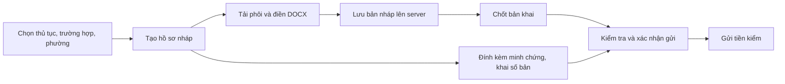

# Kế hoạch tích hợp API và hoàn thiện UI/validation DocumentForm

Ngày rà soát: **16/10/2026 (Asia/Saigon)**. Trạng thái: **đã triển khai phần FE có hợp đồng; chưa xác minh luồng Azure bằng tài khoản thật**. Tài liệu này thay thế đánh giá hiện trạng trong kế hoạch ngày 15/10; các bảng baseline bên dưới ghi nhận thời điểm lập kế hoạch.

> **Cập nhật triển khai 16/10/2026:** theo yêu cầu tiếp theo, đã triển khai phần FE có hợp đồng trong P0–P3 và bổ sung kiểm thử P4. Các mục “hiện trạng” bên dưới là baseline trước triển khai. Xem kết quả kiểm tra và giới hạn thực tế ở `PROGRESS.md`; các phụ thuộc BE tại mục 9 vẫn còn, chưa tích hợp thử nghiệm Azure bằng tài khoản thật.

## 1. Phạm vi và bằng chứng

- Đã đọc `E:/môtảapi.docx` như tài liệu tham khảo nghiệp vụ/kiểm thử; các bước đăng nhập, lấy token, upload, duyệt trong file không phải lệnh đã thực thi.
- Đã GET Swagger UI, `index.js` và [OpenAPI DocumentForm trên Gateway](https://wardmate-gateway.blackmeadow-a2f12767.japaneast.azurecontainerapps.io/api/document-form/swagger/v1/swagger.json) trong lượt này. Xác nhận discovery cán bộ, query PDF `submissionId`, DTO PDF có `submissionId`, hai API QR. Đếm **26 thao tác nghiệp vụ**, cộng `GET /` kỹ thuật; số 23 trong DOCX đã cũ.
- Đã đối chiếu source local DocumentForm, ApplicationWorkflow, cấu hình YARP tại `E:/wardmate-backend`: controllers, `ApplicationAccess`, commands/queries, DTO, validators và `docs/system-constraints.md`. Workflow trong lượt này được xác minh bằng source, chưa đọc lại Swagger Workflow Azure.
- Đã đọc ghi chú bàn giao, chuẩn UI/UX, FRONTEND_SETUP, design-system-and-auth, Officer, Procedure Management và code FE liên quan. FE bắt đầu trên main, HEAD `91cb439`, cây làm việc sạch.
- Swagger xác nhận hợp đồng được công bố; chưa chứng minh quyền theo tài khoản, DB/migration, Blob, Gotenberg hoặc binary chạy đúng. Chưa đăng nhập, gọi mutation hoặc đọc hồ sơ thật.

## 2. Hiện trạng so với yêu cầu

| Phần | Hiện trạng xác minh | Việc cần làm |
| --- | --- | --- |
| Phôi biểu mẫu | FE có danh sách/tạo/upload/xem/tải thật | Tái sử dụng, đồng bộ quyền ghi với policy PROCEDURE_MANAGER |
| Công dân | Có tạo hồ sơ, lưu/chốt DOCX, minh chứng, gửi/gửi lại qua API | Tách lưu nháp/chốt; xử lý thành công từng bước; validation tại chỗ và xác nhận gửi |
| Discovery cán bộ | BE/Azure có by-application; contents đã mở theo quyền | Thêm client/hook/UI bản khai; không còn bị chặn thiếu submissionId |
| Đọc tài liệu | FE mới tải minh chứng, tải tất cả binary khi mở; một file lỗi có thể làm mất cả danh sách | Metadata trước, binary khi chọn; phân biệt ảnh/PDF/DOC/DOCX và lỗi từng tệp |
| Annotate DOCX | Client có, UI chưa nối | Tải bản khai thật → sửa/thêm Word comments trong Word → upload lại |
| Quyết định | FE gọi Workflow; POST quyết định DocumentForm cũng chuyển tiếp toàn hồ sơ | Giữ một quyết định cấp hồ sơ; không gọi thêm cho từng bản khai |
| Nhận xét cán bộ | Có fallback local khi POST lỗi, xóa local, view model mất OPEN/RESOLVED | Chỉ server là đã lưu; giữ status/version/target và guard đúng OPEN hiện tại |
| PDF | BE/Azure có submissionId nullable và query filter; Zod FE chưa khai báo nên bỏ trường này | Giữ trường và nhóm theo bản khai; không đoán bằng tên/thứ tự |
| QR | BE có metadata/PNG; FE còn icon và toast tải thành công giả | PNG có xác thực, metadata thật, xử lý chưa có QR |
| Preview cán bộ | Tab PDF còn HTML minh họa, dữ liệu/ký số/VNeID cố định | DOCX thật trước duyệt, PDF thật sau duyệt; bỏ xác nhận chưa có bằng chứng |
| Danh sách cán bộ | Pending chỉ trả SUBMITTED/UNDER_REVIEW; FE dùng cho cả cần bổ sung/đã duyệt | Cần nguồn danh sách rộng hơn; không coi trống queue là không có hồ sơ |

Nguồn FE: `src/lib/api/documentForms.ts`, `src/hooks/useDocumentForms.ts`, `src/lib/api/workflowAdapters.ts`, `src/hooks/useWorkflow.ts`, `src/pages/citizen/CitizenPage.tsx`, `src/pages/citizen/components/DossierChecklistView.tsx`, `GeneratedDocumentsPanel.tsx`, `src/pages/citizen/views/CitizenQrCodeView.tsx`, `src/pages/officer/OfficerPage.tsx`, `OfficerReviewWorkspaceView.tsx`.

## 3. Phương án triển khai đề xuất

1. Workflow quyết định trạng thái hồ sơ, version, comments và thụ lý; DocumentForm quản lý phôi/bản khai/minh chứng/PDF/QR; Catalog giữ cấu hình. Hồ sơ đã tạo dùng metadata checklist/snapshot Workflow, tránh lấy cấu hình Catalog mới đè lên yêu cầu cũ.
2. Hoàn thiện tải DOCX → sửa bằng Word → upload. `docx-preview` chỉ xem; `FormDocxEditorModal` là contentEditable/toast, chưa nhập/xuất DOCX thật và hiện không được checklist gọi. Không đưa modal đó trở lại như editor đã tích hợp.
3. Hai POST quyết định DocumentForm là đường thay thế cho quyết định toàn hồ sơ. UI giữ nút Workflow hiện có; không thêm nút “duyệt riêng tờ khai” gây hiểu sai và không gọi cả hai service cho một quyết định.
4. Không thêm dependency/engine Word hoặc bịa endpoint. Phần thiếu hợp đồng tách ở mục 9; các phần đã rõ có thể triển khai độc lập.
5. APPROVED là đã duyệt tiền kiểm, công dân chỉ đọc; PDF/QR không phải giấy hẹn, kết quả giải quyết thủ tục hoặc xác nhận tiếp nhận chính thức.

## 4. Ma trận API → nơi gọi → kết quả UI

Tất cả đường dẫn có prefix `/api/v1`. “Đã có” vẫn cần hồi quy khi sửa luồng.

| API thực tế | Nơi gọi / request | Kết quả UI và phần còn lại |
| --- | --- | --- |
| GET `/form-templates`; GET `/{templateId}` | Kho/bộ chọn phôi, page/pageSize/isActive/searchCode | Đã có; trạng thái tải/lỗi/trống và phôi chưa có file |
| POST `/form-templates` | Quản lý: JSON code/title | Đã có; giới hạn trường, trùng mã, quyền role |
| POST `/form-templates/{templateId}/upload-docx` | Multipart file | Đã có; xác nhận thay phôi, invalidate sau thành công |
| GET `/form-templates/{templateId}/download-docx` | Binary qua JWT client | Đã có preview/tải thật, không mở URL Blob backend trực tiếp |
| GET `/citizen/submissions`; GET `/{submissionId}` | applicantId từ phiên, status/page/pageSize | Client có; theo hồ sơ ưu tiên contents không phân trang, không dùng riêng 100 bản ghi đầu để tìm |
| POST `/citizen/submissions/draft` | Multipart TemplateId/ApplicationId/ChecklistId/ApplicantId/File | “Lưu bản nháp”, dùng submissionId server; có rồi thì cập nhật |
| PUT `/citizen/submissions/{submissionId}/draft` | Multipart ApplicantId/File | “Thay bản nháp”; giữ linkage, sửa khi Workflow cho phép |
| POST `/citizen/submissions/{submissionId}/submit` | JSON applicantId | “Chốt bản khai”, tách khỏi lưu nháp/gửi toàn hồ sơ |
| GET `/citizen/submissions/{submissionId}/download-docx` | Query applicantId từ phiên | Tải bản đã lưu, gồm Word comments nếu có |
| GET `/applications/{applicationId}/contents` | Công dân hoặc cán bộ đủ quyền | Nguồn fileExists/status/metadata, ghép checklist; loading/error/empty riêng |
| GET `/officer/submissions/by-application/{applicationId}` | Sau khi xác minh thụ lý | Thêm client/hook nhận array summary; id là submissionId; summary không có fileExists |
| GET `/officer/submissions/{submissionId}/download-docx` | Cán bộ chọn bản khai | Preview DOCX thật hoặc tải sửa Word; binary theo nhu cầu |
| PUT `/officer/submissions/{submissionId}/annotate-docx` | Multipart File | Lưu bản có ghi chú; chỉ UNDER_REVIEW/đúng thụ lý, không tự tạo OPEN comment |
| POST `/officer/submissions/{submissionId}/request-revision` | Đường thay thế: JSON comment, officerId optional | Chuyển tiếp toàn hồ sơ; UI chính dùng Workflow, không gọi trùng |
| POST `/officer/submissions/{submissionId}/approve` | Đường thay thế: officerId optional | Tương tự; nếu gửi officerId phải trùng JWT sub |
| GET/POST `/applications/{applicationId}/supporting-documents` | Upload File/ChecklistId/SubmissionType/DocumentCopyType/Quantity | Đã có; thêm số bản thực tế của tệp, không tự gán quantity yêu cầu cho mọi file |
| DELETE `/supporting-documents/{documentId}` | Chủ hồ sơ khi được sửa | Xác nhận xóa, khóa lúc chờ, kiểm tra lại mức đủ và checklist DRAFT |
| GET `/supporting-documents/{documentId}/download` | Công dân/cán bộ chọn file | PDF/ảnh preview; DOC/DOCX không nhận nhầm là PDF |
| POST `/applications/{applicationId}/generate-pdf` | Multipart SubmissionId/DocumentType, không File | Chỉ Workflow APPROVED + submission Approved; ORIGINAL_SUBMISSION mặc định |
| GET `/applications/{applicationId}/generated-documents` | Có query submissionId | Thêm param/schema/cache key, nhóm PDF đúng bản khai; dữ liệu cũ null tách riêng |
| GET `/generated-documents/{documentId}/download` | Chọn PDF cụ thể | Tải/preview binary, đúng tên và ngày tạo |
| GET `/applications/{applicationId}/approved-qr` | Chọn hồ sơ APPROVED | Thêm schema id/applicationId/submissionId/qrCodeValue/generatedAt |
| GET `/applications/{applicationId}/approved-qr/image` | Sau metadata thành công | Thêm binary PNG; Blob URL tạm để img hiển thị, thu hồi khi đổi/unmount; tải ảnh thật |

Workflow tái sử dụng client/hooks đã có: tạo/lấy hồ sơ; PATCH checklist DRAFT; submit/resubmit; pending/assign/comments/approve/request-revision/reject; versions/diff. Không tự thêm hợp đồng sửa formData DRAFT, xóa/resolve comment hay tiếp nhận tại quầy.

## 5. Luồng UI/UX cần bổ sung

### 5.1. Công dân chuẩn bị và gửi

- Giữ CTA “Chuẩn bị hồ sơ” và procedureId/caseCode có sẵn. Form tạo dùng React Hook Form/Zod, phường IAM thật; nhiều case phải chọn rõ. Không tạo khi danh mục bắt buộc đang lỗi.
- Checklist thể hiện loại bản/hình thức/số bản cần và đã khai, trạng thái file đã lưu riêng với đã được cán bộ kiểm tra. Mobile dùng card dễ đọc thay bảng bắt buộc rộng 780px.
- Tờ khai hiển thị tiếng Việt: chưa có / nháp đã lưu / đã chốt / cần sửa / đã duyệt. Lưu nháp không tự chốt; chốt không đồng nghĩa gửi tiền kiểm.
- Nếu lưu file thành công nhưng chốt hoặc PATCH checklist lỗi: báo rõ bước đã lưu, có “Chốt lại”/“Đồng bộ checklist”; không bắt upload lại. `handleUpdateChecklistItem` hiện bắt lỗi rồi không ném lại, cần cho caller biết PATCH thất bại để tránh toast thành công sai.
- Xóa/thay minh chứng xong refetch contents, tính lại mức đủ và cập nhật checklist khi DRAFT. Không cho gửi khi mutation tài liệu đang chạy.
- Trước gửi/gửi lại: kiểm tra bằng chứng mới nhất và checklist, tóm tắt mục thiếu có link focus; Modal Radix xác nhận với câu: “Tôi đã kiểm tra thông tin và hiểu rằng đây là yêu cầu tiền kiểm, chưa phải nộp hồ sơ hành chính chính thức.”
- DRAFT chưa có snapshot là version 0; không query comments với version 0 hoặc tự nâng thành v1. Sau gửi thành công dùng version server cấp.

### 5.2. Cán bộ đọc, ghi chú và quyết định

1. Queue → **Nhận xử lý** qua assign → tải chi tiết đúng quyền. Mở xem không tự assign; UNDER_REVIEW của mình thì tiếp tục. 409 có người khác nhận thì tải lại queue.
2. Tab “Bản khai” dùng discovery + contents ghép checklistId/templateId; thể hiện file thiếu/legacy rõ ràng. Không dùng ID minh chứng làm ID bản khai.
3. Tải binary khi chọn, hủy khi đổi hồ sơ và thu hồi Blob URL; loading/lỗi/thử lại từng file. Một file lỗi không làm cả hồ sơ trống.
4. DOCX: tải bản hiện tại → thêm Word comments bên ngoài → upload annotate → refetch metadata/binary. Thành công chỉ báo “Đã lưu bản khai có ghi chú”, chưa báo đã yêu cầu bổ sung.
5. Bổ sung: tạo ít nhất một OPEN comment Workflow đúng mục/version rồi gửi lý do và gọi request-revision Workflow một lần. Annotate Word không thay thế điều kiện OPEN.
6. Duyệt: chỉ UNDER_REVIEW, đúng người thụ lý, query comments thành công và không có OPEN version hiện tại. Không chặn bằng tổng comments lịch sử; không cho xóa/resolve giả ở local.
7. Modal chung cho duyệt/bổ sung/từ chối: khóa thao tác khi chờ, giữ mở nếu lỗi, chỉ rời sau server thành công. Timeout quyết định phải đọc lại trạng thái trước khi gửi lại.
8. Trước duyệt xem DOCX thật; sau duyệt mới PDF. Bỏ HTML tờ khai giả, địa chỉ/ngày/ký số cố định và “Dữ liệu khớp VNeID” khi không có nguồn xác minh.

### 5.3. Sửa và gửi lại

- OPEN comments đúng version có link đến checklist/tờ khai; RESOLVED cũ nằm lịch sử và không chặn duyệt.
- NEED_REVISION cho sửa submission còn Submitted vì controller xác minh WorkflowAllowsEdit. Lưu lại thành Draft phải chốt lại.
- Không PATCH checklist khi NEED_REVISION. Resubmit dùng contents mới, đủ chính xác tập GUID checklist, PENDING/COMPLETED, formData hiện có và expectedVersionNumber thật; lỗi không làm mất file đã lưu.
- Sau thành công dùng application/version response, invalidate detail/list/comments/versions/diff/contents. Không tự resolve ở FE; BE resubmit xử lý OPEN cũ. Gửi lại về SUBMITTED, không tự duyệt.

### 5.4. PDF và QR

- PDF dưới từng bản khai, thời gian tạo và tải đúng documentId. submissionId null hiển thị “PDF chưa xác định bản khai nguồn”; không đoán.
- Query chỉ khi APPROVED. Tạo PDF invalidate cả PDF lẫn QR vì có thể tạo QR lần đầu. Khi contents đồng bộ Approved, làm mới metadata submission liên quan.
- QR chỉ cho chọn hồ sơ APPROVED có ID thật; thay icon bằng PNG BE, ngày từ generatedAt, tải ảnh thật. Nếu hỗ trợ in thì “In mã QR” sau khi có ảnh; bỏ “In phiếu hẹn”/toast kết nối máy in giả.
- **Giới hạn luồng HTTP đã lần theo:** approve đi qua ApplicationAccess.Decide → Workflow → Check đồng bộ Approved, không gọi ApproveSubmissionCommandHandler có đoạn tạo QR. GET QR chỉ đọc DB. Nhánh đang được HTTP sử dụng tạo QR còn thiếu là generate-pdf; do đó vừa APPROVED có thể GET QR trả 404.
- FE trước mắt hiển thị “Hồ sơ đã duyệt, chưa có mã QR”, hướng dẫn tạo PDF nếu có bản khai Approved. Không tự POST khi mở tab QR, không retry 404 vô hạn. Hồ sơ không có DOCX chưa có đường tạo QR này.
- ApprovedQrService mặc định mã hóa `/api/v1/applications/{id}` có xác thực; không quảng bá là tra cứu công khai/kiosk. DTO QR chưa có workflowVersion; không khẳng định xác thực chính xác phiên bản.
- Câu bắt buộc: “Duyệt tiền kiểm không thay thế việc tiếp nhận hồ sơ chính thức. Cán bộ sẽ đối chiếu giấy tờ khi bạn đến.”

## 6. Ma trận validation và lỗi

| Dữ liệu/thao tác | Ràng buộc đã xác minh / cách FE thể hiện |
| --- | --- |
| ID/danh tính | GUID không empty; applicantId từ phiên, không nhập; checklist thuộc application, template khớp metadata. Server vẫn kiểm tra quyền |
| Tạo hồ sơ | procedureId thật; wardCode bắt buộc ≤50, tồn tại IAM; caseCode ≤100, đúng case; formData JSON object ≤65.536 byte UTF-8 |
| Phôi | Code trim 1–50, title trim 1–255; 409 trùng mã ở ô mã; dùng mẫu hoạt động/có file |
| DOCX phôi/bản khai/annotate | Không rỗng, .docx, ≤20 MiB. BE kiểm tra độ dài thực, OpenXML/body/Document, không VBA, ≤5.000 entry/100 MiB giải nén. FE không cam kết kiểm tra trường nghiệp vụ bên trong Word |
| Minh chứng | Không rỗng, ≤20 MiB; pdf/jpg/jpeg/png/doc/docx. Không mô tả là đã quét virus/xác nhận hợp lệ |
| Số bản | Số nguyên 1..2.147.483.647; khai số thực tế trong tệp. Mức đủ là tổng quantity fileExists cùng checklist/loại bản/hình thức, không suy số bản từ số trang |
| Metadata file | SubmissionType NOP/XUAT_TRINH; DocumentCopyType ORIGINAL/CERTIFIED_COPY/REGULAR_COPY, hoặc null theo hợp đồng khi không có yêu cầu. Có cấu hình thì phải dùng đúng |
| Quyền ghi | Công dân chỉ DRAFT/NEED_REVISION, Approved khóa; annotate chỉ UNDER_REVIEW/đúng thụ lý. Guard dùng trạng thái API, tránh nhãn view model |
| Comment | version >0 hiện tại; targetId ≤100, label ≤255, text trim 1–4.000. FORM_FIELD JSON Pointer escape ~0/~1, node thực trong snapshot; CHECKLIST_ITEM GUID checklist, không ID file |
| Quyết định | Bổ sung cần OPEN hiện tại + lý do trim 1–4.000; từ chối lý do 1–4.000. Duyệt không còn OPEN; query comment lỗi không coi là hết lỗi |
| Gửi lại | expectedVersionNumber >0, đủ tập checklist, không null/trùng/thêm/bớt, chỉ PENDING/COMPLETED; BE kiểm tra lại bằng chứng |
| Danh sách/diff | page 1..1.000.000, pageSize 1..100; pending chỉ SUBMITTED/UNDER_REVIEW; ngày từ ≤ ngày đến; 0 < fromVersion < toVersion |
| PDF | submission thuộc application, Approved + Workflow APPROVED, không File thay thế; PDF null source không tự gán |
| QR/link | Chỉ hiển thị mã khi metadata/PNG thành công; link HTTP(S) không credentials; không img src trực tiếp endpoint cần Bearer |

Lỗi tiếng Việt tại ô/mục, aria-invalid/aria-describedby, tóm tắt bấm để focus; Toast bổ trợ. Dùng Modal/hook dữ liệu chưa lưu chung. Không lưu/log token hoặc nội dung hồ sơ.

| Mã/trạng thái | Phục hồi |
| --- | --- |
| 400/422 + errors/missingItems | Ánh xạ trường/checklist, giữ file đã lưu và form, không hiện nguyên JSON |
| 401 | JWT client refresh; thất bại về /dang-nhap với returnTo nội bộ an toàn |
| 403/404 phạm vi | Báo không truy cập/không tìm thấy trong phạm vi. Không mặc định sai phường luôn 403: ApplicationAccess có nhánh 404 |
| 404 QR chưa có | Trạng thái chưa có QR và hướng dẫn; không coi là hết phiên |
| 409 draft_exists | Refetch contents và mở bản hiện có, không tạo lặp |
| 409 locked/concurrent_edit/concurrent_update/version_conflict | Đọc lại trạng thái/version, giữ dữ liệu chưa gửi để đối chiếu, không ghi đè mù |
| 503 workflow/storage/sync/pdf | Báo dịch vụ/bước lỗi, thử lại; quyết định có thể đã ghi thì đọc trạng thái trước |
| Error binary Blob | Parse ProblemDetails rồi map code/title/detail/traceId; không tải JSON lỗi thành PDF/PNG |

## 7. Client, cache và proxy

- `documentForms.ts`: officer list, QR metadata/PNG, GeneratedDocumentDto.submissionId nullable, param filter, lỗi QR/sync/lock/validation; giữ auth hiện tại.
- `useDocumentForms.ts`: query key có userId/applicationId; generated có submissionId/filter; enabled theo phiên/role/ID/trạng thái, signal hủy. Cache RAM/xóa theo danh tính như nền tảng.
- File mutations invalidate contents/metadata; checklist invalidate Workflow detail; submit/resubmit/approve/request-revision invalidate xuyên service theo applicationId, gồm comments/versions/diff/QR/PDF phù hợp. Factory key và hooks thống nhất để không invalidate nhầm page/filter/user.
- QR metadata thành công mới tải PNG; không tự retry 401/403/404/409; giữ retry query mạng/5xx nền và không auto retry mutation. Không polling binary/hồ sơ tĩnh; giữ smart polling đã có.
- `vite.config.ts`: route DocumentForm đứng trước `/api/v1/applications` Workflow; thêm approved-qr và approved-qr/image. Regex hiện kết thúc `$` có thể trượt khi thêm query submissionId; cần nhận cả query và kiểm thử route thực tế.
- YARP đã có route QR/generated riêng. FE vẫn cần proxy đúng khi origin Workflow khác DocumentForm; không hardcode Azure vào src/config. `vercel.json` chỉ SPA fallback: production bật proxy cần hosting route `/api` tương ứng, không suy từ Swagger 200.

## 8. Thứ tự triển khai và nghiệm thu

| Đợt | Phạm vi/file chính | Điều kiện hoàn tất |
| --- | --- | --- |
| P0 — Hợp đồng/nền tảng | documentForms.ts, useDocumentForms.ts, useWorkflow.ts, vite.config.ts, workflowAdapters.ts, types/officer.ts | Có discovery/QR/filter; không mất submissionId/status/version; cache identity; QR/PDF query đúng service |
| P1 — Cán bộ | OfficerPage, OfficerReviewWorkspaceView, tái sử dụng DocxPreview/Modal | Nhận xử lý rõ, đúng DOCX, annotate thật, OPEN server guard, không fallback/xóa giả, quyết định chỉ một lần |
| P2 — Công dân/bổ sung | CitizenPage, CitizenDossierDetailView, DossierChecklistView | Nháp/chốt/gửi riêng, số bản thực, lỗi từng bước, xác nhận gửi, sửa/chốt/resubmit version đúng, F5 không mất tài liệu |
| P3 — PDF/QR | GeneratedDocumentsPanel, CitizenQrCodeView, hooks | Nhiều bản khai có PDF riêng; legacy không ghép nhầm; ảnh/tải QR thật; 404 có hướng dẫn; không phiếu hẹn giả |
| P4 — Kiểm thử/tích hợp | Tests theo hành vi và bàn giao | Static/mock đạt, ghi riêng kiểm thử Azure; phần thiếu BE không gắn nhãn hoàn tất |

Kiểm tra khi triển khai:

1. Chạy typecheck/lint/build; auth/core/routing liên quan chạy jwt-client/design-system/landing. Edge hiện cấu hình port 4317.
2. Tái sử dụng tests/officer.spec.ts, citizen-application-wizard.spec.ts, form-templates.spec.ts; thêm test tài liệu khi cần: discovery/annotate, lưu thành công/chốt hoặc PATCH lỗi, nhiều file/số bản, OPEN/RESOLVED/POST lỗi, hai tờ khai/PDF/filter, QR 404/PNG lỗi, đổi tài khoản/cache, timeout/409 quyết định.
3. Kiểm thử Vite route với target kiểm soát: QR metadata/image, generated-documents có/không query sang DocumentForm; application/detail/submit sang Workflow. Browser intercept riêng chưa chứng minh Vite đúng route.
4. Lifecycle mock: v1 → OPEN + annotate → NEED_REVISION → sửa/chốt/resubmit v2 → comments cũ RESOLVED → nhận xử lý → duyệt → hai PDF theo hai submission → QR. Reload và lỗi từng bước không sinh dữ liệu giả.
5. Negative: 0 byte/đúng ngưỡng/vượt 20 MiB, file DOCX giả/hỏng/macro bằng BE thật, sai template/checklist/owner, sai phường/chưa assign/tự duyệt, chưa APPROVED, QR chưa có, PDF legacy null; status theo source, không ép 400/403 từ tài liệu khi source trả 409/404.
6. Sau mock dùng tài khoản/dữ liệu thử nghiệm được cấp riêng: dân A/B, cán bộ đúng/sai phường, PROCEDURE_MANAGER/IT_ADMIN; xác minh Blob/Gotenberg/Word comments/PDF sạch comment/QR quét được. Không coi JSON hoặc health check là binary đã đúng, không lưu credential vào repo.
7. Desktop/mobile 360/390px, bàn phím, focus Modal/lỗi, zoom 200%, loading/error/empty và mạng chậm.

Lượt lập kế hoạch này chỉ kiểm tra nội dung/đường dẫn/diff và GET Swagger; **không chạy lại typecheck/lint/build/Playwright/build BE** và không dùng kết quả lịch sử như vừa chạy.

## 9. Phụ thuộc và quyết định còn chờ

Chi tiết: [DOCUMENT_FORM_BACKEND_GAPS.md](DOCUMENT_FORM_BACKEND_GAPS.md).

- Có thể làm ngay discovery/contents/annotate bằng Word, PDF theo submissionId, QR có sẵn, validation/cache/proxy và sửa UI giả.
- QR ngay sau duyệt cần BE tích hợp tạo vào luồng HTTP thực sự chạy, xử lý hồ sơ không có DOCX, đồng thời và linkage version. Tra cứu QR công khai cần hợp đồng trang đích/quyền/dữ liệu tối thiểu; không tự mở API riêng tư.
- Danh sách cán bộ ngoài pending cần API cho NEED_REVISION/APPROVED/REJECTED/lịch sử/tổng số. Trong lúc chưa có, UI ẩn hoặc giải thích giới hạn mục thiếu nguồn, không truyền filter bị BE cấm.
- Ghi phôi hiện chỉ PROCEDURE_MANAGER; FE có thể căn policy ngay. Mở ghi IT_ADMIN cần quyết định BE/IAM riêng.
- Chưa có snapshot blob theo version, cập nhật formData DRAFT, xóa/resolve/reopen comment thủ công hoặc tiếp nhận tại quầy. Resubmit đã tự resolve comment cũ, không phải hoàn toàn thiếu lifecycle comment.
- Editor Word trong trình duyệt cần chốt engine có nhập/xuất DOCX bảo toàn Word comments/định dạng/font/bảng, hạ tầng và license. Đây là hạng mục riêng.

Không cần chờ các quyết định trên để làm phần FE đã có hợp đồng. Lượt hiện tại chỉ lập kế hoạch, chưa sửa chức năng/BE, chưa commit/push/deploy.
